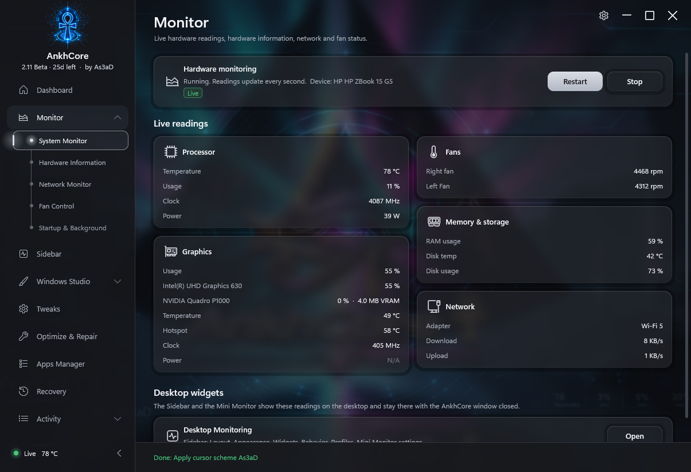
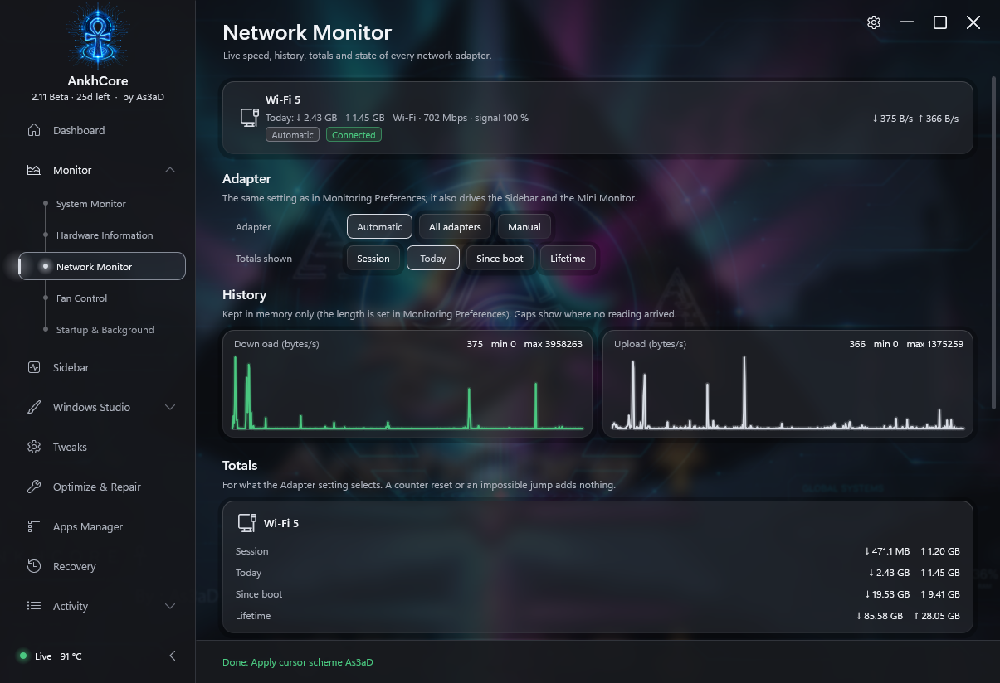
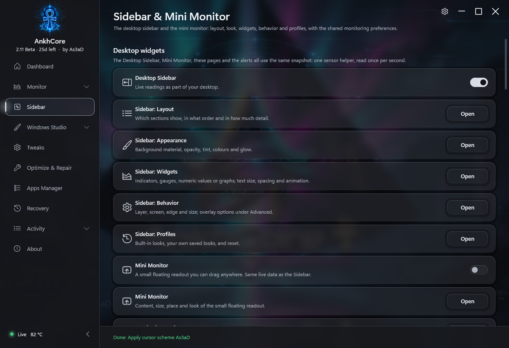
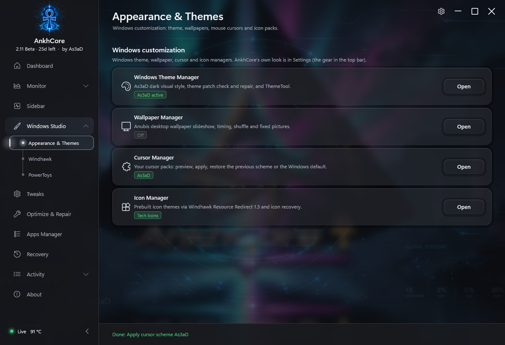
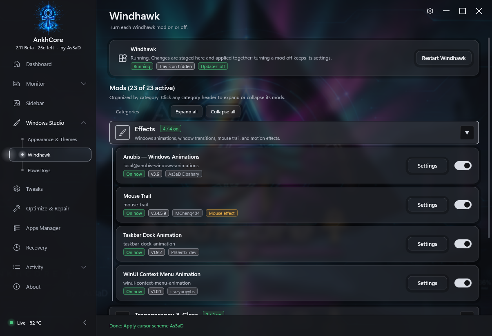

# AnkhCore Control Center

A Windows desktop application that combines system monitoring, maintenance, customization,
application management and recovery in one place. Native C++ (Win32), built for 64-bit
Windows 10 and Windows 11.

> **Status:** Beta. Some features depend on your Windows version, hardware and
> third-party components (see [docs/FEATURES.md](docs/FEATURES.md) for the full reference
> and its limitations).

## Highlights

- **Monitor** - live CPU, graphics, memory, storage, network, fans and temperatures,
  hardware information, and a built-in **fan-control engine** (243 notebook
  configurations, minimum-speed control, thermal override, return to BIOS automatic).
- **Desktop Sidebar and Mini-Monitor** - a docked widget that stays on the desktop
  without taking screen space or mouse input. Sections, order, size, material, tint,
  layer and saved profiles are configurable.
- **Windows Studio** - themes, wallpapers (shuffle), cursor schemes, icon themes,
  [Windhawk](https://windhawk.net) mod management and PowerToys controls.
- **Tweaks** - 29 reversible Windows behavior tweaks; each one says what it changes and can be undone.
- **Optimize & Repair** - one read-only Smart scan (caches, temp files, broken shortcuts,
  application updates, Windows updates), process manager, storage health (SMART),
  DISM / SFC and other Windows tools. Scanning never deletes anything.
- **Apps Manager** - installed and Store apps, batch uninstall with leftover cleanup and
  undo, and application updates through a private UniGetUI session.
- **Recovery** - `.acbackup` backups with selective restore, recovery points, and a
  journal of every change with undo.

## Screenshots

| | |
|---|---|
|  **Dashboard** |  **Monitor** |
|  **Fan Control** |  **Network Monitor** |
|  **Sidebar & Mini-Monitor** |  **Windows Studio** |
|  **Windhawk** |  **Optimize & Repair** |
|  **Apps Manager** |  **Recovery** |

## Safety and privacy

- Read first; change only after you choose. Reversible changes have an undo path or a recovery point.
- No registry cleaning. Documents, Downloads, photos, passwords and browser sessions are never touched.
- AnkhCore does not install or restart for Windows Updates and does not change Windows Update policy.
- No telemetry and no location access. Logs and support bundles stay on your PC.
- Fan writes happen only after you confirm a configuration for your computer model.

## Requirements

- 64-bit Windows 10 (1607 or later) or Windows 11. Some features are Windows 11 only.
- Administrator rights for Setup, about 1.1 GB of disk space for the full package.
- Internet access for application updates, Windows Update detection and optional Windhawk compiler use.

## About this repository

This repository contains the **application source** only:

- `src/` - application and installer source (UI and engines)
- `tests/` - unit tests and benchmarks
- `tools/` - build and test scripts (MSVC)
- `docs/` - feature reference, requirements, decisions, screenshots
- `installer/` - third-party notices

Visual effects, Windhawk mods, cursor sets, themes, icon packs, brand artwork and bundled
third-party tools are **not** included, so a full installer cannot be built from this
repository alone.

## Support the project

- Patreon: https://www.patreon.com/As3aDelbahary
- PayPal: https://www.paypal.com/paypalme/as3adelbahary

## Links

- Project page: https://www.facebook.com/AnkhCore.Pts
- Developer (As3aD): https://www.facebook.com/As3aD.Elba7ary

## License

All rights reserved. The source is published for viewing only; see
`installer/THIRD-PARTY-NOTICES.txt` for third-party components.
