# AnkhCore Control Center

A Windows desktop application that combines **system monitoring, maintenance, customization,
application management and recovery** in one place. Native C++ (Win32), built for 64-bit
Windows 10 and Windows 11.

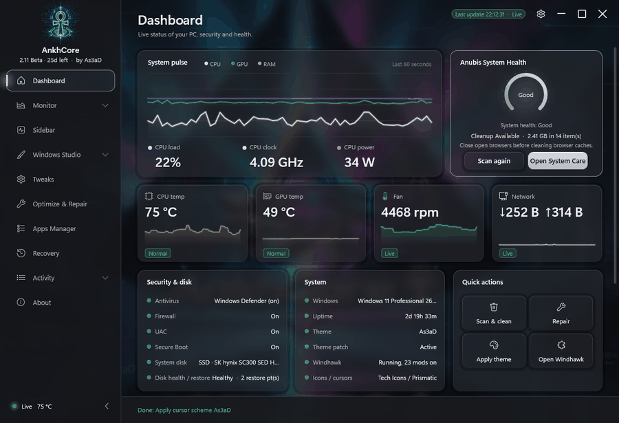

> **Status:** Beta. Some features depend on your Windows version, hardware and third-party
> components; those dependencies are stated next to each feature below.

## Windows animations in action

With the **Anubis - Windows Animations** mod (managed from Windows Studio > Windhawk), ordinary Windows
windows get their own open, close, minimize and restore effects. Everything below is a real recording or
screenshot of the full desktop: the AnkhCore desktop Sidebar on the right, the taskbar at the bottom, and
the theme applied to the Start menu, File Explorer and the quick settings flyout.

**Start menu** - themed with the same translucent acrylic look

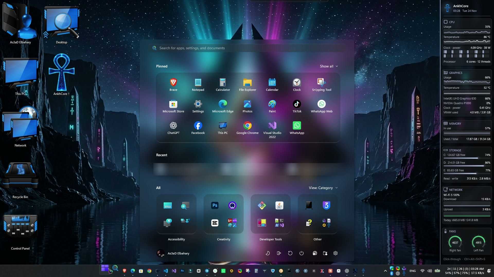

**File Explorer ("This PC")** - open, with the theme and acrylic blur

**Quick settings** - Wi-Fi, Bluetooth and the other tiles

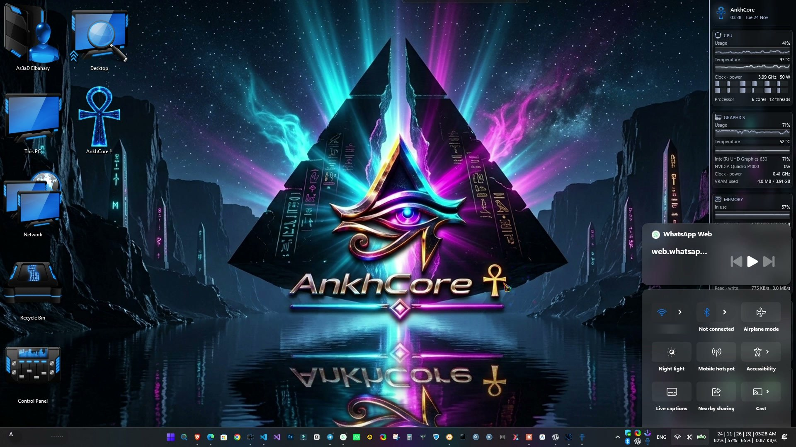

**Window effects in motion** - the same windows, a different animation each time

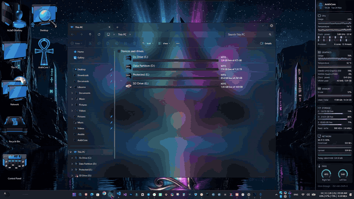

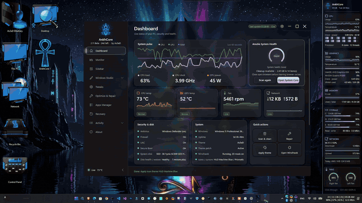

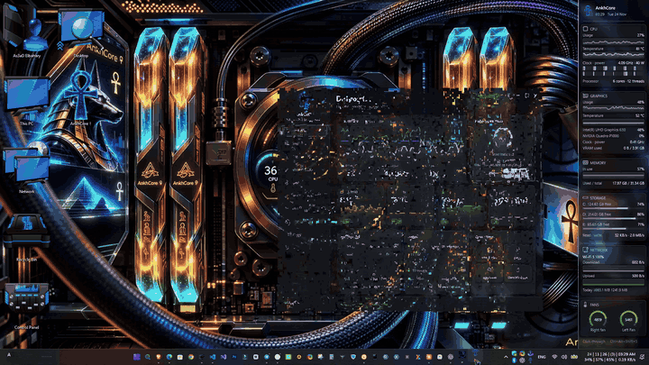

**A restore caught mid-effect, and the full desktop**

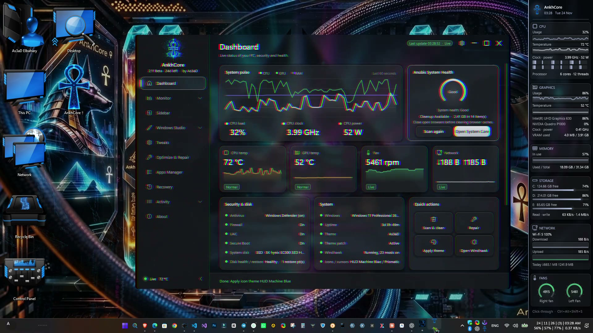

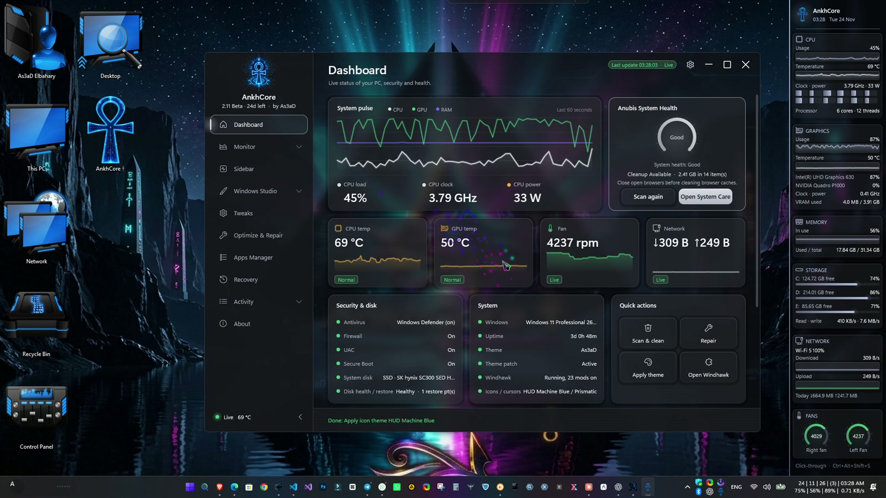

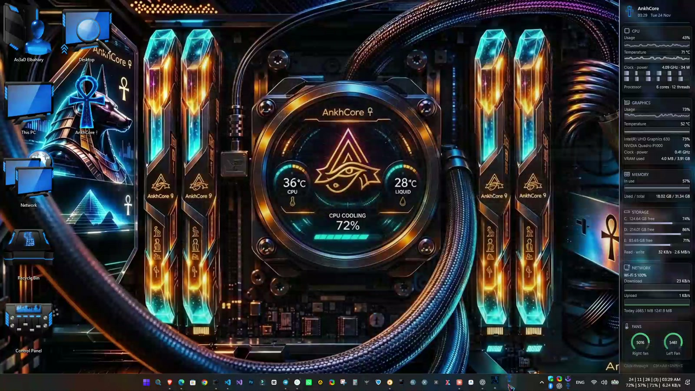

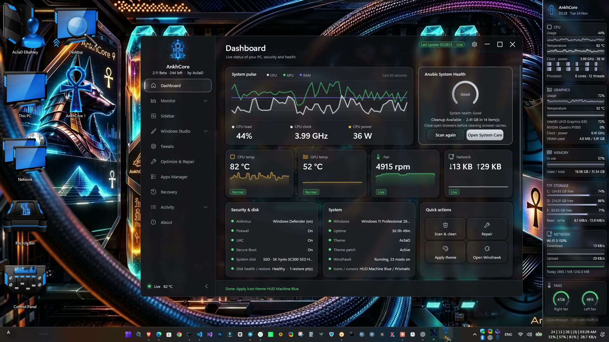
## Contents

1. [Main navigation](#main-navigation)
2. [Dashboard](#dashboard)
3. [Monitor](#monitor)
4. [Sidebar and Mini-Monitor](#sidebar-and-mini-monitor)
5. [Windows Studio](#windows-studio)
6. [Tweaks](#tweaks)
7. [Optimize & Repair](#optimize--repair)
8. [Apps Manager](#apps-manager)
9. [Recovery](#recovery)
10. [Activity](#activity)
11. [Settings](#settings)
12. [Installer](#installer)
13. [Safety, privacy and reversibility](#safety-privacy-and-reversibility)
14. [Requirements](#requirements)
15. [About this repository](#about-this-repository)

## Main navigation

Dashboard · Monitor · Sidebar · Windows Studio · Tweaks · Optimize & Repair · Apps Manager ·
Recovery · Activity · About. The Settings button opens the configuration categories.

## Dashboard

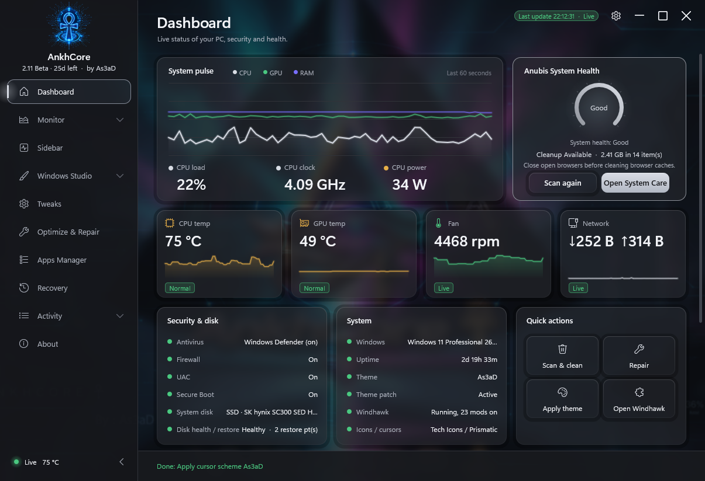

- **Anubis System Health** gauge: reflects the last scan result, a cleanup preview and the first problem found.
- Live tiles for CPU, graphics, memory, storage, network and fans, with a 60-second system pulse graph.
- Security and disk summary (antivirus, firewall, UAC, Secure Boot, system disk, disk health / restore points).
- System summary (Windows version, uptime, theme, theme patch, Windhawk state, icons / cursors).
- Quick actions: Scan & clean, Repair, Apply theme, Open Windhawk. Scan actions route to System Care.

## Monitor

### System Monitor
Live system readings, graphs and historical monitoring data.

### Hardware Information
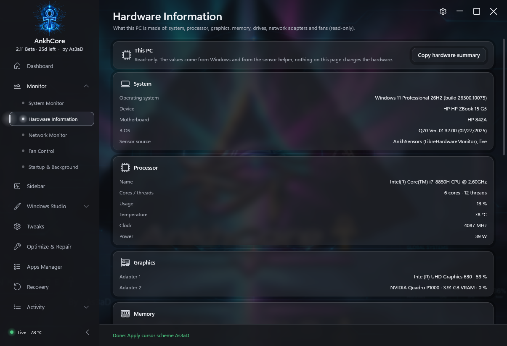

Hardware inventory (system, processor, graphics, memory, drives, network adapters, fans), which
sensors AnkhCore can read, a copyable hardware summary, a hardware report and a device profile.
Read-only: nothing on this page changes the hardware.

### Network Monitor

Adapters, live speed, download / upload history graphs, transfer totals (session, today, since
boot, lifetime), Wi-Fi signal information, and automatic / all / manual adapter selection.

### Fan Control
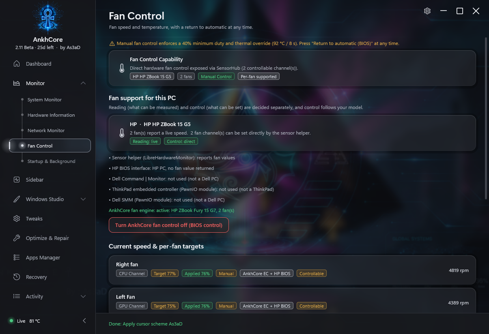

AnkhCore includes its own fan-control engine.

- Shows which fans are present and distinguishes values that can be **read** from fans that can be **controlled** on the current PC.
- **243 built-in notebook configurations**; you choose and confirm the configuration for your computer model.
- **Minimum fan-speed control** that increases with temperature.
- **Thermal override** at 92 °C for 8 seconds.
- **Return to automatic** hands control back to the BIOS.
- Never lowers fans below the hardware's own behavior.
- Limits: actual fan writes depend on the notebook's embedded controller. Some Lenovo Legion, ASUS, MSI and Acer models may not expose a supported driverless reader; unsupported hardware is reported as "not exposed" with the reason.

### Startup & Background
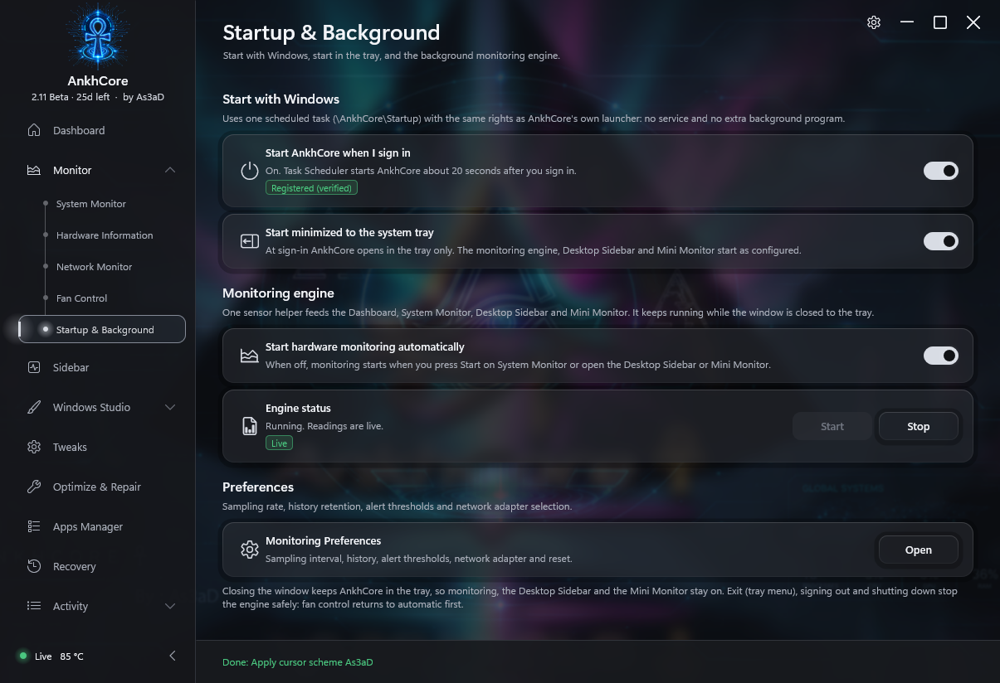

Start with Windows (scheduled task, no service), start minimized to the system tray, and a
background monitoring engine that keeps the Sidebar and Mini-Monitor running while the window is closed.

### Monitoring Preferences
Sampling frequency, history length, alerts and thresholds, toast and tray notifications, network adapter selection.

## Sidebar and Mini-Monitor

The Sidebar is a desktop widget docked to a screen edge. It stays part of the desktop without
reserving screen space or taking mouse input.

- **Sections:** CPU, Graphics, Memory, Storage, Network, Fans.
- **Detail levels:** Minimal, Standard, Detailed.
- **Visual styles:** Indicators, Gauges, Numeric values, Graphs. The Network section presents download and upload separately.
- **Layout:** choose visible sections, change their order, width, height, screen edge and target display.
- **Appearance:** opacity, material (Solid, Frosted, Acrylic), tint, accent colors, text size, spacing, glow, animation.
- **Display layer:** Desktop (default), Below windows, Normal, Always on top.
- **Saved appearance profiles.**
- **Mini-Monitor:** a small floating system readout with its own appearance configuration.

## Windows Studio

### Appearance & Themes
- **Theme Manager:** the BIB and BIB3 theme families (theme application is Windows 11 only), theme patch check and repair.
- **Wallpaper Manager:** Anubis / AnkhCore wallpapers, shuffle and interval setting.
- **Cursor Manager:** AnkhCore cursor schemes, preview, apply, and restore the previous scheme or the Windows default.
- **Icon Manager:** icon themes applied through Windhawk Resource Redirect, with icon recovery.

### Windhawk

[Windhawk](https://windhawk.net) is integrated as a tool managed through AnkhCore: mods are listed in
collapsible categories, with per-mod settings and staged application. No automatic Windhawk update and
no extra Windhawk shortcuts.

Documented mod catalog (22):
Anubis - Windows Animations · Icon Resource Redirect · Translucent Windows · Windows 11 Start Menu Styler ·
Notification Center Styler · File Explorer Styler · Custom Corner Radius · Dynamic Island for Windows ·
Taskbar Clock Customization · Taskbar Dock Animation · Taskbar Notification Icon Spacing ·
Taskbar Start Button Colorizer · Taskbar Button Click · WinTips OSD · Overhauled Alt-Tab ·
Slick Window Arrangement · Mouse Trail · UxTheme Hook · File Operation Styler ·
Explorer Tree Item Tweaker · Win11 Power Buttons · WinUI Context Menu Animation.

**Anubis - Windows Animations** includes numbered window animation effects, Reality Effects, a
signature library and random packs. The exact catalog depends on the installed Anubis mod build.

### PowerToys
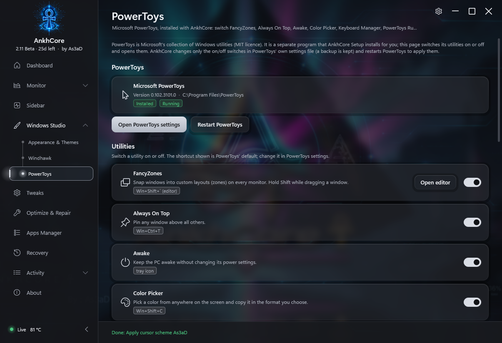

Setup can install Microsoft PowerToys (skipped when already installed). AnkhCore provides controls for
**16 PowerToys utilities** by changing each utility's `enabled` flag, and keeps a backup.

### After Dark for Windows 10
Setup detects the Windows 10 release (1607 through 22H2) and installs a matching After Dark pack where one exists.

## Tweaks

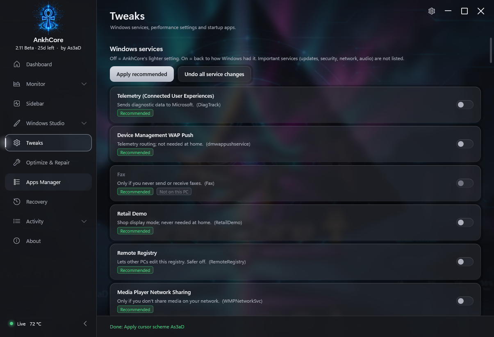

29 reversible Windows behavior tweaks (for example telemetry, Device Management WAP Push, retail demo,
remote registry, Media Player network sharing). Each tweak describes what it changes, and every change can be undone.

## Optimize & Repair

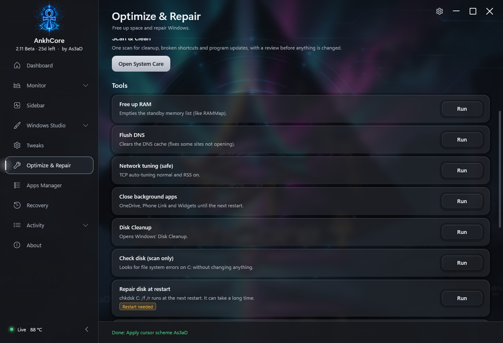

### System Care (Smart scan)
One **read-only** scan for:
- Cleaner items (caches, temporary files) and eight application caches.
- Broken shortcuts.
- Application updates and Windows updates.

Each finding carries a classification (**Cleanable**, **Review required**, **In use**, **Protected**), evidence, size and an Ignore action.

- Scanning never deletes files. Cleanable items start selected; Review-required items do not.
- Space is counted only after a second measurement.
- **Clean Selected** cleans only what you selected. **Update All / Fix All** performs only supported safe actions.
- Broken shortcuts are moved to a recovery folder and can be undone.

### Windows Updates
Detect updates offered by Windows Update, select individual updates, download only the ones you chose, with
progress, cancel and background download. AnkhCore does **not** install Windows updates, restart Windows,
or change Windows Update settings, policies or services.

### Process Manager
List processes, change priority, select CPU cores, efficiency mode, end an ordinary application, automatic
rules and Restore. Critical and security processes are protected.

### Drivers · Storage · Windows Tools · Repair
- **Drivers:** driver area under Optimize & Repair.
- **Storage:** disk health and SMART information through the bundled smartctl 7.5.
- **Windows Tools:** DISM, SFC and other Windows utilities, plus quick tools such as free up RAM, flush DNS, network tuning, close background apps, disk cleanup and check disk.
- **Repair:** repair actions, including a scheduled repair after restart.

## Apps Manager

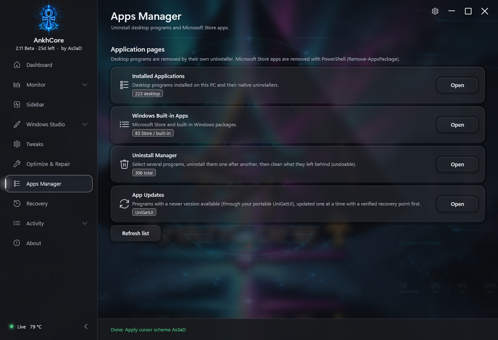

- **Installed Apps** and **Built-in / Store Apps** inventories.
- **Uninstall Manager:** select several programs and run each program's own uninstaller one after another, clean supported leftovers, use a recovery folder, and Undo recoverable cleanup.
- **App Updates** (a private UniGetUI session, separate from Windows Update): Update All or one by one, create a recovery point first, verify afterwards, cancel between programs, Skip this version, Always skip, Restore skip settings.

## Recovery

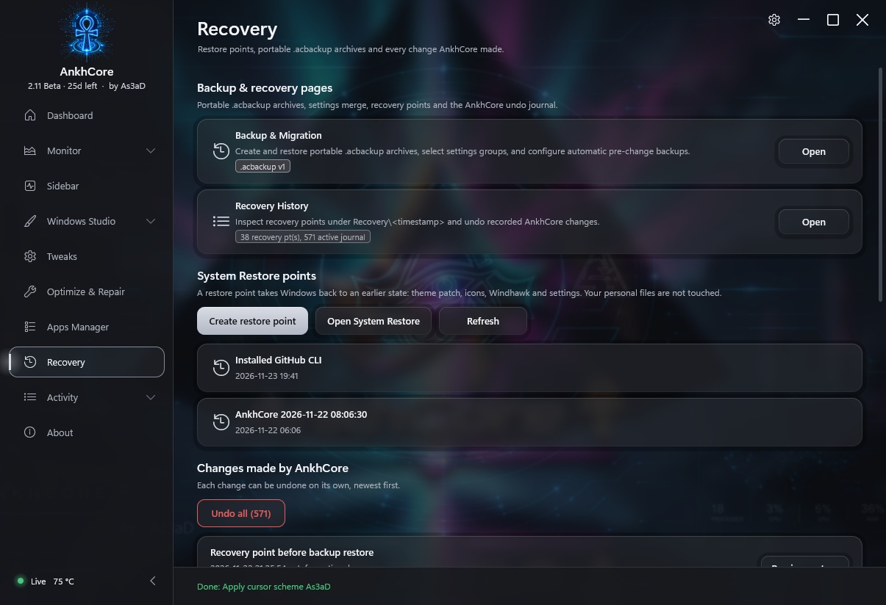

- **Backup & Migration:** portable `.acbackup` archives with selective restore, settings merge, and automatic pre-change backups.
- **Recovery Points:** create and manage restore points for supported reversible changes.
- **Recovery History:** a journal of every change AnkhCore made, with Undo for supported operations (individually or all).

## Activity

Operation history and error log, with Export log, Export support bundle (.zip) and Open log folder.

## Settings

Seven categories: **General · Appearance · Performance · Notifications · Updates · Privacy · Advanced.**

Appearance controls: window material (**Acrylic, Frosted, Wallpaper Glass, Solid, Clear Glass**), tint, blur,
glow, motion and battery behavior.
- Acrylic / frosted use Windows 11 22H2 or later; older Windows versions get a simulated wallpaper glass.
- Solid is used when transparency is disabled, high contrast is on, or Battery Saver requires it.
- Clear Glass makes the window itself see-through and applies a light wallpaper blur inside cards.

## Installer

Supports fresh install, update, repair, clean install and rollback (`--rollback`).

- Pages: Welcome → Options → Install → Completion (Restart Later is the default, Restart Now, Finish). The installer never restarts Windows automatically.
- Package components (Windhawk, IconThemes, Mods, WindowsAssets, AfterDark, PowerToys, Tools) are verified against a `COMPONENTS.sha256` manifest before installation.
- New installs use the developer-selected default appearance profile; updates keep your own settings.
- Backups and personal files are not deleted by any setup mode.

## Safety, privacy and reversibility

- Read first; change only after you choose. Reversible changes have an undo path or a recovery point.
- No registry cleaning. Documents, Downloads, photos, passwords and browser sessions are never touched.
- No automatic Windows Update installation or restart, and no change to Windows Update policies.
- **No telemetry and no location access.** Logs and support bundles stay on your PC (they may contain folder paths).
- The sensor helper reads hardware information; fan writes happen only after you confirm a configuration.

## Requirements

- 64-bit Windows 10 (1607 or later) or Windows 11. Theme application is Windows 11 only.
- Administrator rights for Setup; about 1.1 GB of disk space for the full package.
- Internet access for application updates, Windows Update detection and downloads, and the optional Windhawk compiler.
- Fan control, After Dark, acrylic materials and some Windhawk operations depend on hardware, Windows version or components.

The full reference is in [docs/FEATURES.md](docs/FEATURES.md).

## About this repository

This repository contains the **application source** only:

- `src/` - application and installer source (UI and engines)
- `tests/` - unit tests and benchmarks
- `tools/` - build and test scripts (MSVC)
- `docs/` - feature reference, requirements, decisions, screenshots
- `installer/` - third-party notices

Visual effects, Windhawk mods, cursor sets, themes, icon packs, brand artwork and bundled third-party
tools are **not** included, so a full installer cannot be built from this repository alone.

## Support the project

- Patreon: https://www.patreon.com/As3aDelbahary
- PayPal: https://www.paypal.com/paypalme/as3adelbahary

## Links

- Project page: https://www.facebook.com/AnkhCore.Pts
- Developer (As3aD): https://www.facebook.com/As3aD.Elba7ary

## License

All rights reserved. The source is published for viewing only; see
`installer/THIRD-PARTY-NOTICES.txt` for third-party components.
